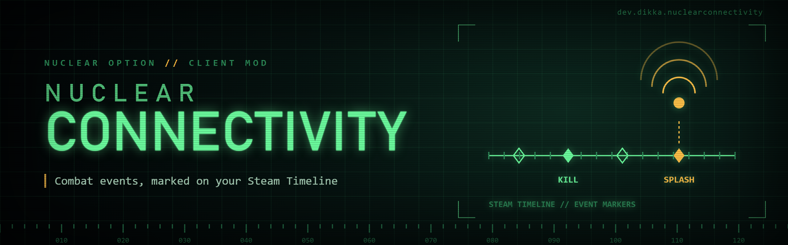

# NuclearConnectivity

`NuclearConnectivity` is a client-side `Nuclear Option` mod for connectivity and external integration features.

The first implemented slice is Steam Timeline marker support for a few high-value combat events.

## Planned Scope

- external integration hooks for multiple services and tools
- a home for future connectivity-related features guided incrementally
- Discord rich presence is planned later

## Current Features

- optional Steam Timeline integration
- marker when the local aircraft is disabled with its main pilot dead (successful ejection is excluded)
- marker on credited air-to-air kills
- optional marker on credited air-to-ground kills

## Requirements

- `Nuclear Option`
- `BepInEx 5`

## Installation

1. Install BepInEx for `Nuclear Option`.
2. Build or download a release archive.
3. Extract the `NuclearConnectivity` folder into `BepInEx/plugins/`.

The final layout should look like this:

```text
BepInEx/
  plugins/
    NuclearConnectivity/
      NuclearConnectivity.dll
```

## Configuration

Current config file:

- `BepInEx/config/dev.dikka.nuclearconnectivity.cfg`

Current switches:

- `Enable Steam Timeline`
- `Mark Player Death`
- `Mark Air-to-Air Kills`
- `Mark Air-to-Ground Kills`

Implementation notes:

- credited kill markers are sourced from `KillDisplay.DisplayKill`
- local aircraft loss markers are sourced from `Unit.UnitDisabled`, retaining the previously observed cockpit aircraft through HUD removal
- Steam Timeline must be available in the game's shipped Steam API; unsupported native libraries disable markers with a warning

## Local Development Install

1. Copy `.env.example` to `.env`
2. Set `STEAMAPPS_DIR`
3. Run:

```bash
./scripts/install-mod.sh -v
```

## Building

```bash
dotnet build NuclearConnectivity.csproj -c Release
```
