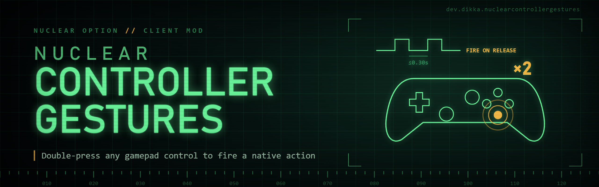

# NuclearControllerGestures

Independent controller double presses for Nuclear Option's regular BepInEx 5 client. No other Nuclear mod is required.

The F1 menu has eight double presses, **Double Press 1** to **8**, all unbound. Each has a **Control** binding and an **Action**. Select **Add binding** under Control and press a gamepad button or D-pad direction, a joystick button or hat direction, or a key; then choose the native button action. For example, bind D-pad left and choose **Eject**, then press and release left twice. The action runs after the second release. The Action list comes from the game's current assignable button actions; axis actions are excluded. A Control can hold several controls; each counts on its own.

A gamepad control works on every assigned gamepad: cardinal D-pad directions, face buttons, shoulders, triggers, stick buttons, Select and Start. Other assigned controllers use their first declared D-pad, or their first POV hat, for gamepad D-pad controls; a joystick binding uses exactly the button, hat direction or axis direction you pressed on that device. Diagonals cancel D-pad gestures. Each gesture belongs to one physical control; presses on separate controls or controllers cannot combine.

Normal game bindings still run on both presses. This mod adds an action and does not consume, delay or replace those bindings. Choose controls whose existing bindings are appropriate. Native action evaluation preserves the game's press/release behavior and restrictions; a double press sends a short action pulse, not a held action. Eject uses the game's native Eject action.

Defaults: maximum gap **0.30 seconds** from first release to second press, maximum duration **0.25 seconds** for each press, and **0.30 seconds** cooldown after success. These three timings are independently configurable. Holds cancel. Input pauses in menus, text entry, configuration windows, the expanded map, and when the game lacks focus or an active local aircraft. Context changes, disconnections and setting changes cancel pending gestures. Return the control to neutral before beginning again.

The separation of press duration and inter-press gap follows the useful distinction in [Unity's MultiTap interaction](https://docs.unity3d.com/Packages/com.unity.inputsystem@1.14/manual/Interactions.html#multitap). Windows' [SetDoubleClickTime documentation](https://learn.microsoft.com/en-us/windows/win32/api/winuser/nf-winuser-setdoubleclicktime) describes a default 500 ms mouse double-click interval; this mod's shorter defaults are gameplay choices, independent of the Windows mouse setting.

Install the DLL under `BepInEx/plugins/NuclearControllerGestures/` using NOMM or your normal BepInEx installation. Configuration is `BepInEx/config/dev.dikka.nuclearcontrollergestures.cfg`. The master Enabled setting turns off recognition. Transient action maps are excluded from native saved controller settings.

Version 0.2.0 moved to these numbered double presses. Each control assigned in the old **Double Press Actions** section (for example `DPadLeft = Eject`) moves once to the next free double press as a gamepad binding with the same action.
