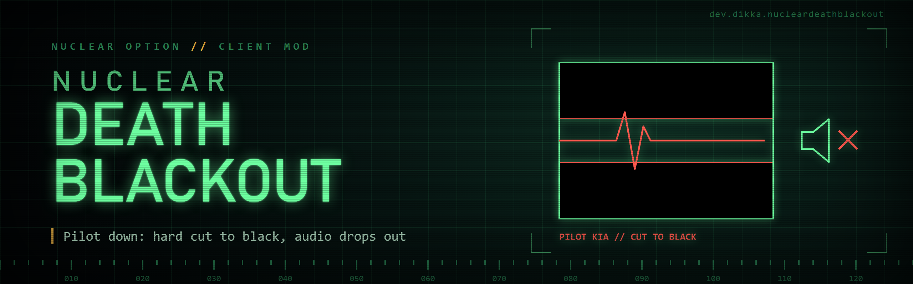

# NuclearDeathBlackout

`NuclearDeathBlackout` is a client-side `Nuclear Option` mod that makes local pilot death feel more abrupt and physical: the screen cuts to black and game audio mutes briefly when your main pilot actually dies.

Successful ejection is intentionally excluded.

## Features

- Full-screen black overlay when the local player pilot dies
- Temporary all-audio mute during the blackout
- Fast configurable fade-to-black and fade-out timing
- Standard BepInEx config only; no custom in-game menu UI
- Ignores successful ejection so bailout does not feel like death

## How It Works

The mod remembers the local cockpit aircraft, monitors its main pilot, and also patches `Unit.UnitDisabled`. This keeps death detection working when the game removes the aircraft from the HUD before its disable event. It triggers once per aircraft when:

- the main pilot exists and `pilot.dead` is true
- the aircraft has not successfully ejected

The visual effect is a top-level Unity screen-space overlay. Audio is muted with `AudioListener.volume` and restored to the previous value after the effect.
Disabling the effect or plugin cancels an active blackout and immediately restores the saved audio volume.

## Requirements

- `Nuclear Option`
- `BepInEx 5`

BepInEx install guide:

- https://docs.bepinex.dev/articles/user_guide/installation/index.html

## Installation

1. Install BepInEx for `Nuclear Option`.
2. Build the mod or download a release archive.
3. Extract the `NuclearDeathBlackout` folder into `BepInEx/plugins/`.

The final layout should look like this:

```text
BepInEx/
  plugins/
    NuclearDeathBlackout/
      NuclearDeathBlackout.dll
```

## Configuration

Config entries are created automatically after the mod loads.

Main config file:

- `BepInEx/config/dev.dikka.nucleardeathblackout.cfg`

Example config:

```ini
[Death Blackout]
## Enable the realistic death blackout effect.
# Setting type: Boolean
# Default value: true
Enabled = true

## Seconds to keep the screen fully black after the local pilot dies.
# Setting type: Single
# Default value: 3.5
# Acceptable value range: From 0.1 to 10
Blackout Seconds = 3.5

## Seconds for the screen to go black. Use 0 for an instant cut.
# Setting type: Single
# Default value: 0
# Acceptable value range: From 0 to 5
Fade In Seconds = 0

## Seconds for the black screen to fade away after the hold time.
# Setting type: Single
# Default value: 0.35
# Acceptable value range: From 0 to 5
Fade Out Seconds = 0.35

## Mute all game audio while the death blackout is active.
# Setting type: Boolean
# Default value: true
Mute Audio = true

## Seconds for audio volume to fade back after the blackout hold time. Use 0 for an instant restore.
# Setting type: Single
# Default value: 0.35
# Acceptable value range: From 0 to 5
Audio Restore Seconds = 0.35
```

## Limitations

- The trigger is intentionally strict: it uses the local main pilot's `dead` state, not every aircraft-loss event.
- Audio muting affects all game audio during the effect.
- If Nuclear Option changes its pilot death or ejection internals, the trigger may need adjustment.

## Local Development Install

For local installs during development:

1. Copy `.env.example` to `.env`
2. Set `STEAMAPPS_DIR`
3. Run:

```bash
./scripts/install-mod.sh -v
```

## Building

This project builds against your local `Nuclear Option` and `BepInEx` assemblies.

Standard local build:

```bash
dotnet build NuclearDeathBlackout.csproj -c Release
```

Build output:

- `bin/Release/NuclearDeathBlackout.dll`
