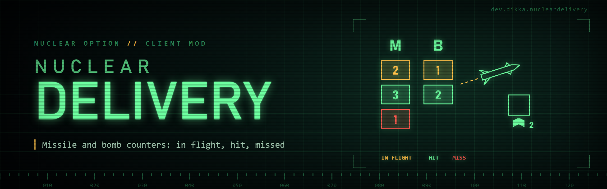

# NuclearDelivery

Missile, rocket and bomb counters on the cockpit radar, target-camera and landing-camera views. Requires BepInEx 5; no other Nuclear mod is required.

Both camera views follow NOTT's display: **M** at the bottom-left, **B** at the bottom-right, with colored counts stacked above each letter, clear of the bottom readouts. The normal cockpit MFD uses horizontal rows at the bottom-left of its radar panel, sized to match the target-camera counters. Empty categories and zero counts disappear, leaving no background panel. The normal rows hide during target/landing camera feeds, which have their own counters.

- **Yellow:** tracked munitions still in flight.
- **Green:** recent detonations where the game reported armor contact, matching NOTT's hit indicator. This is a collision report, not confirmed damage to the selected target; damaging proximity explosions can have no armor contact.
- **Red:** recent detonations without armor contact, removed munitions, or flights past the timeout. This does not distinguish interception from other endings.

**Target engagement markers:** on the target camera, a small green missile icon appears below each target box while a missile or bomb is guiding to that target, so you can see that a target is already engaged before you fire again. A number beside the icon shows when more than one munition is on it. Markers follow the munition's current target, so they disappear when it detonates, loses its target or retargets. By default they count your own and your allies' launches, but never enemy munitions. Turn off **Mark Allied Munitions** to count only your own launches. The idea follows NOTT's ammo conservation indicator. A marker means a munition is on its way, not that it will hit.

Tracking begins at launch, even before selecting a target or opening its camera. Only weapons owned by the currently controlled aircraft count. Bombs use the game's bomb category; other tracked missile objects, including rockets, use M. Recent outcomes expire after three seconds by default; unresolved flights time out after 120 seconds. Leaving the aircraft, ejecting, disabling the mod or unloading clears tracking. Enabling it again begins with new launches.

Use the configuration menu to enable each view independently, adjust counter scale/margins, or change the expiry periods. Target Camera Counter Scale sets the base size for both camera views; Cockpit Counter Scale is a multiplier relative to that size (1 matches it). Radar sizing compensates for the aircraft's panel scale and limits large rows to the available width. Existing preferences are preserved. Settings are in `BepInEx/config/dev.dikka.nucleardelivery.cfg`. The cockpit display follows the aircraft's native radar rectangle and leaves radar and weapon pages intact. Counters appear only while a delivery is in flight or a recent outcome remains.

Import a current modpack through NOMM, or place `NuclearDelivery.dll` in `BepInEx/plugins/NuclearDelivery/`. The old combined NuclearTacticalTools is excluded from current packs. The radar/minimap replacement is a separate feature and is not included here.

Build with the workspace reference environment: `dotnet build NuclearDelivery/NuclearDelivery.csproj -c Release`. Building does not install the mod. Target-camera presentation is derived from [NOTT](https://github.com/clumzy/NO_Tactitools); its MIT notice is included in `THIRD-PARTY-NOTICES.txt`.
