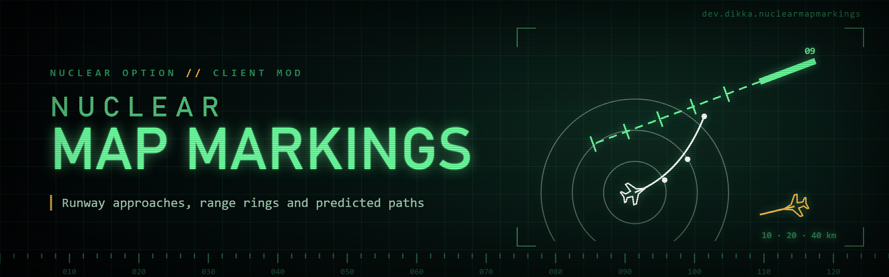

# NuclearMapMarkings

`NuclearMapMarkings` is a client-side `Nuclear Option` BepInEx mod that adds pilot markings to the dynamic map: runways with approach centerlines, range rings around your aircraft and predicted paths.

Every marking has its own switch for the full map and for the minimap. The minimap switch also covers the cockpit minimap that `NuclearMinimap` shows, because that is a copy of the same native map.

## Features

- **Runways and approaches:** runways drawn to scale, with a dashed centerline extending outward from each landing threshold and a cross tick every 1 km. Line length shows runway size within a fixed range: runways up to 600 m get 3 km, runways from 2 km on get 7.5 km. Between those, the line grows more slowly as the runway gets longer, so big bases do not dominate the map. The game log lists each runway's measured length once per map, for tuning. Reversible runways get a line at both ends. Carrier runways follow the ship.
- **Bases:** friendly and neutral bases by default; optionally friendly only or every base. Colors follow the map's friendly/neutral/hostile icon colors. Spectators see every base.
- **Range rings:** faint rings at 10, 20 and 40 km around your aircraft. The distances are configurable, up to eight rings.
- **Predicted paths:** where a unit will be if it keeps its current speed and turn. Your aircraft, units selected on the map and your HUD targets get a long path (60 s by default) with a dot every 10 s. Other moving aircraft get a short 10 s path. Vehicles and ships use three times these lengths, with a dot every 30 s. Missiles and buildings never get paths.
- **Fair use of information:** enemy paths use only your team's actively observed track data, the same data as the native enemy icon. Paths disappear when the track is lost. Changing team clears all motion history.
- Markings draw beneath map icons and labels and keep a constant line width while zooming.

## Requirements

- `Nuclear Option`
- `BepInEx 5`

## Installation

1. Install BepInEx for `Nuclear Option`.
2. Build the mod or download a release archive.
3. Extract the `NuclearMapMarkings` folder into `BepInEx/plugins/`.

```text
BepInEx/
  plugins/
    NuclearMapMarkings/
      NuclearMapMarkings.dll
```

## Configuration

Config entries are created automatically after the mod loads.

Main config file:

- `BepInEx/config/dev.dikka.nuclearmapmarkings.cfg`

Defaults:

```ini
[General]
Enabled = true
Line Width = 1.5

[Runways]
Show On Full Map = true
Show On Minimap = true
## FriendlyAndNeutral, Friendly or All
Bases = FriendlyAndNeutral
Show Approach Lines = true
## Kilometres
Min Approach Length = 3
Max Approach Length = 7.5
## Metres
Short Runway = 600
Long Runway = 2000
Tick Spacing = 1
Opacity = 0.8

[Range Rings]
Show On Full Map = false
Show On Minimap = true
## Kilometres, separated by commas
Distances = 10, 20, 40
Opacity = 0.35

[Predicted Paths]
Show On Full Map = true
Show On Minimap = true
Short Paths For All Units = true
Short Path Seconds = 10
Long Path Seconds = 60
## 0 draws straight lines
Turn Fade Seconds = 6
Opacity = 0.8
```

All values apply live through Configuration Manager.

The prediction measures each unit's speed over the last second and its turn rate over the last two seconds. Speed stays constant. The turn eases out over `Turn Fade Seconds`, so the path bends by at most the current turn rate times that value (about 6 s of turn by default) instead of curling into a loop. Measured turns under about 2°/s count as straight, because they are usually position jitter. Turn rates are capped at about 20°/s for aircraft and 6°/s for vehicles and ships.

Version 0.1.1 fixes paths that turned far too much in 0.1.0, which kept the measured turn rate constant for the whole path. It also changed tick spacing from 2 km to 1 km for new configs. Version 0.1.2 replaces the fixed 15 km line (0.1.0) and the linear 2.5x rule (0.1.1) with the bounded 3 to 7.5 km range above; the old keys `Approach Length` and `Approach Length Per Runway Length` are unused.

## Client testing

On 2026-10-27 the user ran 0.1.0 in their game client and reported that predicted paths turned far too much and that approach lines were too long: Hogshead should be about half its 0.1.0 length. After 0.1.1 the user reported Hogshead too short and Feldspar's long runways too long; 0.1.2's bounded range targets about 7.5 km for both and has not yet been rerun. Actual Hogshead and Feldspar runway lengths are not yet known locally. Other cases were not reported. Offline checks cover the geometry and the motion estimate only.

## Local Development Install

For local installs during development:

1. Copy the workspace `.env.example` to `.env`
2. Set `STEAMAPPS_DIR`
3. Run:

```bash
./scripts/install-mod.sh -v
```

## Building

```bash
dotnet build NuclearMapMarkings.csproj -c Release
```

Build output:

- `bin/Release/NuclearMapMarkings.dll`
