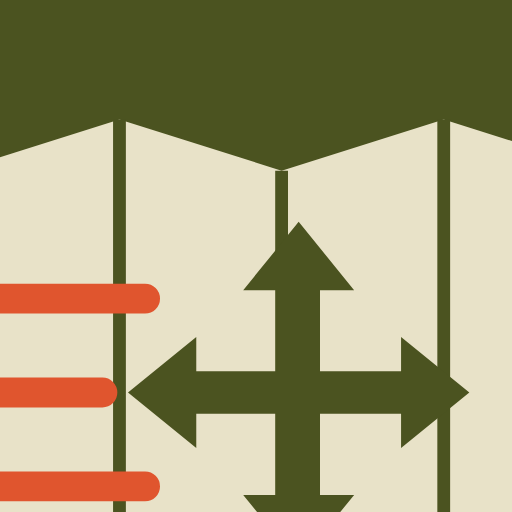

# NuclearMapPan

`NuclearMapPan` is a client-side `Nuclear Option` mod. You set how fast the expanded map moves when you move it with a controller. By default it moves 2.75 times as fast as in the game at full stick, and slower near the stick centre for fine positioning.

## Features

- Faster map movement with a controller stick on the expanded map (default 2.75 times the game's speed at full stick)
- A stick curve you shape with four settings: small stick movements stay precise, full stick is fast
- A diagonal push moves at the same speed as a straight push
- Optional speed for keys bound to Move Map (default: the game's speed)
- Mouse dragging, zoom, the minimized map and the cockpit minimap are not changed

## Settings

`BepInEx/config/dev.dikka.nuclearmappan.cfg`, or F1 with Configuration Manager. Changes apply at once.

| Setting | Default | Meaning |
|---|---|---|
| General / Enabled | true | Off keeps the game's speed |
| Controller / Top Speed | 2.75 | Speed at full stick, as a multiple of the game's full-stick speed (1.05 to 10) |
| Controller / Matches Game At | 0.55 | Stick deflection where the map moves exactly as fast as in the game; slower below, faster above (0.05 to 0.9) |
| Controller / Game Top Speed At | 0.75 | Stick deflection where the map reaches the game's full-stick speed; keep it above Matches Game At (0.1 to 0.95) |
| Controller / Belly | 0.45 | How slowly the map starts near the centre: 1 starts flat, 0 starts at the game's speed (0 to 1) |
| Keyboard / Speed | 1 | Speed for keys bound to Move Map, as a multiple of the game's speed (0.25 to 10) |

The curve is a smooth monotone cubic through those points: it always rises with the stick and never moves the map backwards. The Desmos graph "NuclearMapPan stick curve" shows the same curve with the same four controls.

## How it works

On the expanded map, the game's `DynamicMap.MapControls` reads the Move Map Horizontal and Move Map Vertical actions and moves the map by the stick value times 300 units per second, divided by the zoom. A Harmony transpiler sends those two reads through the mod, which multiplies them. When a controller gives the input (Rewired joystick source), the stick curve applies; otherwise the keyboard speed applies. The game still applies the frame time, the zoom, the map edges and its own map update, so the map moves the same way, only at a different speed.

## Requirements

- `Nuclear Option`
- `BepInEx 5`

## Installation

1. Install BepInEx for `Nuclear Option`.
2. Build the mod or download a release archive.
3. Extract the `NuclearMapPan` folder into `BepInEx/plugins/`.

## Build

From the repository root:

```bash
set -a; source .env; set +a
dotnet build NuclearMapPan/NuclearMapPan.csproj -c Release
```

`scripts/install-mod.sh` builds the mod and copies it into the game's plugin folder.
