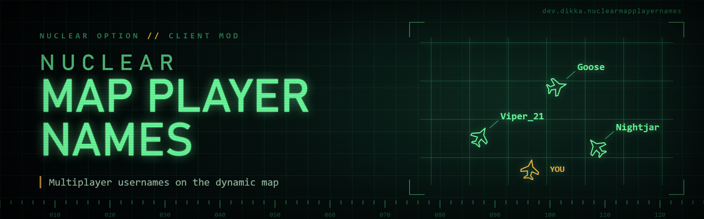

# NuclearMapPlayerNames

`NuclearMapPlayerNames` is a client-side `Nuclear Option` BepInEx mod that shows multiplayer usernames next to player-controlled aircraft on the dynamic map.

The stock game already shows a player's username in the hover tooltip. This mod keeps that behavior but adds always-visible map labels so you do not have to hover over every aircraft to identify real players.

## Features

- Shows usernames next to real/player-controlled aircraft on the dynamic map
- Ignores AI aircraft and unoccupied aircraft
- Config toggle to restore stock hover-only behavior
- Optional setting to show labels only when the map is maximized
- Configurable rendered font size, visual text scale, and label offset
- Option to hide your own aircraft label, enabled by default
- Usernames render as literal text; labels hide when their aircraft map icon is disabled
- Uses the game's player-name font and display-name preferences, including its name filter and optional player indices/server tags

## Requirements

- `Nuclear Option`
- `BepInEx 5`

## Installation

1. Install BepInEx for `Nuclear Option`.
2. Build the mod or download a release archive.
3. Extract the `NuclearMapPlayerNames` folder into `BepInEx/plugins/`.

The final layout should look like this:

```text
BepInEx/
  plugins/
    NuclearMapPlayerNames/
      NuclearMapPlayerNames.dll
```

## Configuration

Config entries are created automatically after the mod loads.

Main config file:

- `BepInEx/config/dev.dikka.nuclearmapplayernames.cfg`

Important settings:

```ini
[Map Player Names]
## Show multiplayer usernames next to player-controlled aircraft on the dynamic map.
Show Player Names = true

## Only show player names when the dynamic map is maximized.
Show Only On Maximized Map = false

Hide Local Player Name = true
Font Size = 12
Text Scale = 0.6
Offset X = 2
Offset Y = 4
```

## Local Development Install

For local installs during development:

1. Copy the workspace `.env.example` to `.env`
2. Set `STEAMAPPS_DIR`
3. Run:

```bash
./scripts/install-mod.sh -v
```

## Building

This project builds against your local `Nuclear Option` and `BepInEx` assemblies.

```bash
dotnet build NuclearMapPlayerNames.csproj -c Release
```

Build output:

- `bin/Release/NuclearMapPlayerNames.dll`
