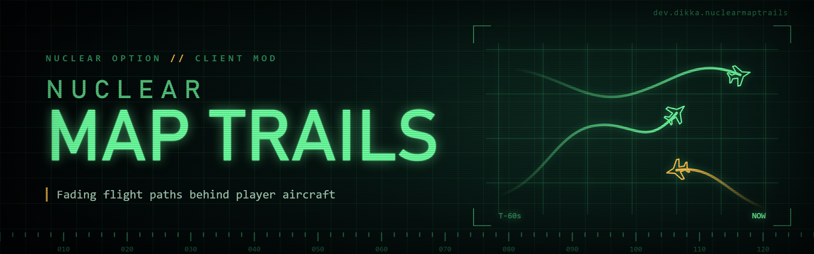

# NuclearMapTrails

`NuclearMapTrails` is a client-side `Nuclear Option` BepInEx mod that draws recent flight paths behind player-controlled aircraft on the dynamic map.

By default it shows trails only for players on your own team, so it does not reveal anything about the enemy. Each trail keeps a configurable number of seconds of flight, fades out toward its tail and is darker where the aircraft flew low.

## Features

- Trails behind real/player-controlled aircraft; AI and unoccupied aircraft are ignored
- Own team only by default; optional enemy trails use only your team's actively observed track data, the same data as the native enemy icon, and break when the track is lost
- Spectators see trails for every player, as they already see every aircraft on the native map
- Trail length in seconds, sample interval and line width
- Fade from the aircraft to the tail, with configurable newest/oldest opacity
- Altitude brightness: each point is shaded by the altitude above sea level at that moment
- Colors follow the live map icon color by default (team-relative theme colors, your own aircraft white); faction colors or two custom colors are available
- Optional maximized-map-only display; trails are still recorded while hidden
- Changing team clears all trails so they never carry knowledge from another team
- Trails draw beneath map icons and labels, so `NuclearMapPlayerNames` labels stay on top

## Requirements

- `Nuclear Option`
- `BepInEx 5`

## Installation

1. Install BepInEx for `Nuclear Option`.
2. Build the mod or download a release archive.
3. Extract the `NuclearMapTrails` folder into `BepInEx/plugins/`.

```text
BepInEx/
  plugins/
    NuclearMapTrails/
      NuclearMapTrails.dll
```

## Configuration

Config entries are created automatically after the mod loads.

Main config file:

- `BepInEx/config/dev.dikka.nuclearmaptrails.cfg`

Defaults:

```ini
[Map Trails]
Show Trails = true
## Friendly or AllVisible
Teams = Friendly
Show Own Trail = true
Show Only On Maximized Map = false
## Seconds of flight kept per trail
Trail Duration = 60
Sample Interval = 0.5
Fade Out = true
Newest Opacity = 0.85
Oldest Opacity = 0
Altitude Brightness = true
## Metres above sea level
Low Altitude = 0
High Altitude = 8000
Low Altitude Brightness = 0.45
Line Width = 2
## IconColor, FactionColor or Custom
Color Mode = IconColor
Custom Friendly Color = 4DBFFFFF
Custom Enemy Color = FF594DFF
```

All values apply live through Configuration Manager. Disabling `Show Trails` or changing `Teams` clears the recorded trails.

## Local Development Install

For local installs during development:

1. Copy the workspace `.env.example` to `.env`
2. Set `STEAMAPPS_DIR`
3. Run:

```bash
./scripts/install-mod.sh -v
```

## Building

```bash
dotnet build NuclearMapTrails.csproj -c Release
```

Build output:

- `bin/Release/NuclearMapTrails.dll`
