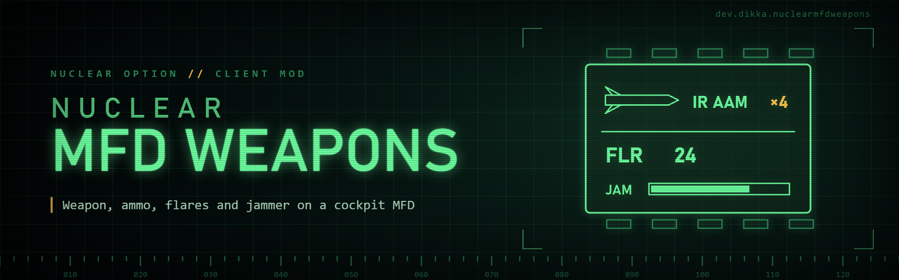

# NuclearMfdWeapons

A regular BepInEx 5 client mod showing the selected weapon icon, name, ammo or reload percentage, flares and jammer charge in the cockpit. The presentation follows Nuclear Option Tactical Tools: the native HUD font, theme-aware text and divider, the stock weapon icon's dimensions, and enlarged bold text for the selected countermeasure. A black, bordered loadout popup sizes itself to its station text and highlights the selected row on entry and station changes. No NOTT installation is required; the source-only NuclearMfd helper is bundled into this DLL.

Press **F8** (or the control you bind to **Controls / Toggle Cockpit Page**) to switch between the custom and stock cockpit page. Switching back restores the stock weapon HUD. Config changes apply during flight.

| Config | Default | Effect |
|---|---|---|
| General / Enabled | true | Enable the display. |
| Display / Show Stock Weapon HUD | false | Keep stock weapon and countermeasure readouts and the aircraft outline alongside custom content. |
| Display / Show Capacitor HUD | false | Show the native capacitor indicator at the top-right screen edge, independently of the stock weapon HUD setting. |
| Display / Replace Cockpit Content | true | Replace the mapped cockpit panel. Chicane retains its flight instruments. |
| Display / Loadout Preview | true | Show weapon stations briefly. |
| Display / Loadout Preview Duration | 1 second | Preview duration, 0.1–10 seconds. |
| Controls / Toggle Cockpit Page | F8 | Binding: add a key, gamepad button or joystick button in F1 (Add binding). Ignored while typing, in menus and on the full map. |

The config file is `BepInEx/config/dev.dikka.nuclearmfdweapons.cfg`. The mod hides the complete stock weapon HUD container, including its gray backing, countermeasure readouts and the separate aircraft outline while a working custom display is active. The capacitor indicator is off by default; enable it separately to show it against the top edge. On VT-7, the native cockpit nozzle label moves beside its glyph when the measured panel has room. Damage overlays, failure indicators and damage audio keep running. Stock HUD, capacitor and nozzle placement, and Chicane instrument transforms are restored on page changes, disable, ejection, aircraft changes and teardown. Missing or unrecognized cockpit layouts retain stock content.

Install `NuclearMfdWeapons.dll` under `BepInEx/plugins/NuclearMfdWeapons/`. Keep this README and THIRD-PARTY-NOTICES.txt with redistributed packages. Do not redistribute the game's assemblies or BepInEx core files as part of this mod.

## Compatibility and acceptance

Stock mappings include Cricket, Compass, **VT-7 Vagrant**, UH-90 Ibis, Chicane, Brawler, Revoker, Vortex, Tarantula, Ifrit, EW-25 Medusa, SFB-81 Darkreach and Alkyon. Older Ibis, Medusa and Darkreach names remain accepted. Vagrant uses the existing SystemStatus panel with the same weapon/popup composition as Compass. These mappings cover the current stock roster; they are not a claim that every aircraft's rendering has passed a flight test.

The project builds against client references. This verifies API compilation, not visible cockpit rendering. The cockpit mappings and per-aircraft placements derive from NOTT and require flight checks on the game version you use. Validate text, icons, ammo, reload, flare selection and jammer selection; change weapon stations; toggle F8; change settings live; eject and respawn. Confirm the stock UI returns correctly and Chicane gauges remain usable. Check Darkreach rotation and Alkyon sizing specifically. Unknown aircraft deliberately retain stock UI.

Avoid combining cockpit panel replacements from multiple mods on the same screen.

## Building

Load the workspace SDK and reference environment, then run `dotnet build NuclearMfdWeapons/NuclearMfdWeapons.csproj -c Release`. This builds only. The optional `scripts/install-mod.sh` separately builds and copies into a configured game installation.

Weapon placements and preview placements are adapted from the MIT-licensed Nuclear Option Tactical Tools by George Pied. See THIRD-PARTY-NOTICES.txt for the preserved permission notice.
