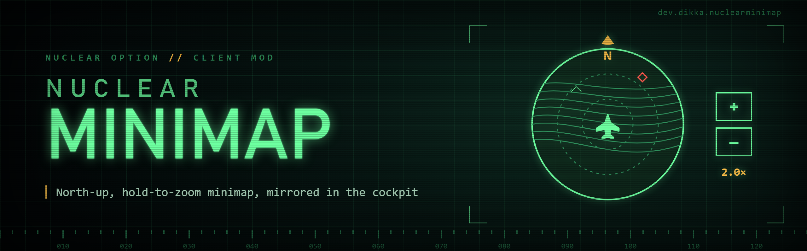

# NuclearMinimap

Adds orientation and hold zoom to the native HUD minimap, plus an optional cockpit display of that same live minimap. Terrain, native icons, grid and enabled map labels stay native. Target and landing camera feeds remain available, and NuclearDelivery's cockpit counters stay above the cockpit map.

**Display / Show Cockpit Minimap** defaults to **on**. Turn it off to keep the stock cockpit radar and HUD placement while continuing to use minimap orientation and hold zoom. The HUD visibility choices below apply only while this cockpit feature is enabled.

In the F1 configuration menu, **Display / HUD Minimap** offers:

- **HideWhenMfdVisible** (default): hide the HUD minimap, its panel backing and small heading-reference dot while the cockpit map is displayed; show them again during camera feeds or if the cockpit map is unavailable.
- **AlwaysShow**: keep the HUD minimap alongside the cockpit map.
- **AlwaysHide**: hide the minimized HUD map, its panel backing and heading-reference dot.

The expanded map remains available in every mode. Disable **General / Enabled** to restore stock radar, HUD presentation, orientation and zoom controls.

**Display / Minimap Orientation** selects **NorthUp** (default) or **HeadingUp** (rotates with your aircraft). Both the HUD and MFD use the same orientation and zoom, centered on your aircraft even at high zoom. Existing saved orientation choices are preserved.

Version 0.4.2 makes the cockpit map cheaper to draw: it no longer re-sorts its copy of every map icon on each update, only when icons appear or disappear.

Version 0.4.3 makes the cockpit map much cheaper again. Each copied icon keeps its shape and is only moved when the map pans, turns or zooms; an icon's shape is reread only when the game redraws it, and every copy is refreshed once a second as a safety net. Copies outside the cockpit map's frame are skipped when the screen is drawn.

Version 0.4.4 also shows the cockpit map while you spectate. With NuclearSpectator, which builds the cockpit screens of an aircraft you watch from its cockpit, the map appears on that aircraft's screen, centered on it and with its heading. It stays on the whole time, because the pilot you watch cannot switch the screen to a camera feed. Hold zoom works there too.

## Flight instruments on the cockpit minimap

The cockpit minimap also shows small flight instruments, so it can work as a moving-map display. Each one has its own toggle under **Flight Instruments** in the F1 menu:

- **Show Heading Tape** (on): a compass tape along the top, with the heading as a three-digit number in the centre box.
- **Show North Indicator** (on): a north arrow in the top-left corner. It appears only with **HeadingUp** orientation, because north is always up in NorthUp.
- **Show Attitude Indicator** (on): a small attitude ball (artificial horizon) with sky and ground, pitch lines every 10 degrees, a fixed bank scale (10, 20, 30, 45 and 60 degrees), a yellow bank pointer and a fixed aircraft symbol.
- **Show Bank Angle** (on): the bank angle beside the ball, for example **R30** (right wing down) or **L15**.
- **Attitude Indicator Corner** (BottomRight), **Attitude Indicator Size** (0.3 of the map's shorter side) and **Instrument Opacity** (0.9).

The bottom-left corner holds NuclearDelivery's counters, so it is not the default. A top-corner ball moves below the heading tape if the two would overlap. The instruments use the HUD's green theme colour and font, and appear only while the cockpit minimap is shown. The HUD minimap is unchanged.

## Zoom controls

**Controls / Zoom In** and **Controls / Zoom Out** are bindings in the F1 Configuration Manager menu, with the same editor as every other key and button setting in these mods (see `Shared/NuclearBindings/README.md`). Defaults are gamepad **D-pad up** and **D-pad down**; on an assigned controller without a gamepad layout they use its D-pad or POV hat.

Select **Add binding** and press the control: a key (with Ctrl, Shift or Alt for a combination), a mouse button, a gamepad control, or a joystick button, hat direction or axis direction past halfway. Several controls per direction and several devices work together, including a stick and throttle. Let axes settle first; a button already held when capture starts must be released and pressed again, so maintained switches can stay on. Relative mouse movement and wheel pulses cannot be held and are not captured. Axis zoom uses a fixed halfway threshold; it does not scale the zoom rate with deflection.

Each row shows its device and control. **Remove** deletes that row; the reset button restores the D-pad defaults. A joystick row belongs to that device (Rewired's persistent device GUID, or a unique hardware match without one) and stays saved while it is disconnected. A joystick row replaces the gamepad defaults **on that joystick only**. The same control cannot zoom in and out.

Version 0.5.0 moved the earlier **Hold Zoom In / Out**, **Controller Hold Zoom In / Out** and **Device Zoom Bindings** settings into these two bindings once, keeping every saved control.
The zoom range extends eight times farther out and 60% closer in than earlier versions. Hold past **Zoom Hold Delay** (default **0.3 seconds**) to zoom continuously; release stops immediately. Opposing directions cancel. **Zoom Speed** adjusts the rate.

These controls work on the minimized map whether shown in the HUD, MFD, or both. They pause during menus, text entry, the F1 configuration window and loss of focus. The expanded map keeps its native orientation, controls and opening zoom; returning to the minimap restores your chosen zoom.

**Controls / Consume Zoom Bindings** defaults to **on**: a **short tap** triggers the normal game binding on release; a **long hold** zooms without triggering that binding, including when released. For example, tap D-pad down for gear and hold it for zoom out. Normal taps wait until release so the mod can distinguish them from holds. **Zoom Hold Delay** is adjustable from 0.1 to 1 second. Other controls bound to the same action still work. Keyboard chords reserve their main key during the press; modifiers remain available. Turn consumption off to allow the native action during zoom holds too. Saved game assignments are preserved, and menus and the expanded map use their normal bindings.

For custom axis directions, consumption applies only to native **button actions** mapped to that same axis direction. Full-axis and analog actions remain active while zooming; the editor marks these shared axes. For example, binding a flight-stick axis to zoom also leaves its flight control active. A device without a native game assignment can still zoom, but has no native tap action to replay. Learning controls happens in the configuration menu; its normal game input rules still apply.

The mod uses the aircraft's native radar surface, including nested cockpit layouts, rather than a guessed aircraft name. It mirrors native UI graphics without cloning map controllers, adding a camera, or allocating a map render texture. No other mod is required; the MFD helper is compiled into this plugin as source. Existing map-label settings still decide which labels appear.

Install with NOMM Import Modpack or place `NuclearMinimap.dll` in a BepInEx 5 plugins folder. Configuration is generated as `dev.dikka.nuclearminimap.cfg` after loading.

This replaces NuclearMfdMap. Remove or disable its old DLL before loading NuclearMinimap; the plugins are declared incompatible to prevent duplicate map/input patches. On first load, all saved values from `dev.dikka.nuclearmfdmap.cfg` migrate if the new configuration is absent or contains only headers/comments/sections. Any saved setting in the new configuration prevents import; existing new preferences always win. The original configuration is retained unchanged.
