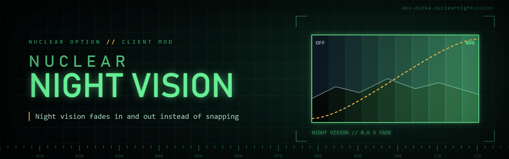

# NuclearNightVision

`NuclearNightVision` is a client-side `Nuclear Option` mod. Night vision fades in and out smoothly instead of switching instantly. You set how long each fade takes.

## Features

- Smooth fade into night vision (default 0.6 s) and back to the normal view (default 0.4 s)
- Gentle start and end of each fade (smoothstep)
- Works for every way night vision switches: the Night Vis binding, the radial menu and automatic night vision when you change camera at night
- Pressing night vision again during a fade reverses it from where it is
- A fade time of 0 keeps the game's instant switch

## Settings

`BepInEx/config/dev.dikka.nuclearnightvision.cfg`, or F1 with Configuration Manager. Changes apply at once.

| Setting | Default | Meaning |
|---|---|---|
| Night Vision / Enabled | true | Fade instead of switching instantly |
| Night Vision / Fade In Seconds | 0.6 | Normal view to night vision, 0 to 5 s |
| Night Vision / Fade Out Seconds | 0.4 | Night vision to normal view, 0 to 5 s |

## How it works

The game's `NightVision.Update` switches between two post-processing volumes: its own night vision volume and the level's normal `LevelInfo.PostProcessing`. A Harmony postfix keeps both volumes enabled during a switch and crossfades their weights. When the fade ends, the enabled flags and weights are the game's own again, so nothing else sees a difference. The night vision brightness gain is the game's own and is not changed.

During a fade into night vision, the cockpit screens keep their normal brightness until the fade ends; the game dims them only when the normal volume is off.

## Requirements

- `Nuclear Option`
- `BepInEx 5`

## Installation

1. Install BepInEx for `Nuclear Option`.
2. Build the mod or download a release archive.
3. Extract the `NuclearNightVision` folder into `BepInEx/plugins/`.

## Build

From the repository root:

```bash
set -a; source .env; set +a
dotnet build NuclearNightVision/NuclearNightVision.csproj -c Release
```

`scripts/install-mod.sh` builds the mod and copies it into the game's plugin folder.
