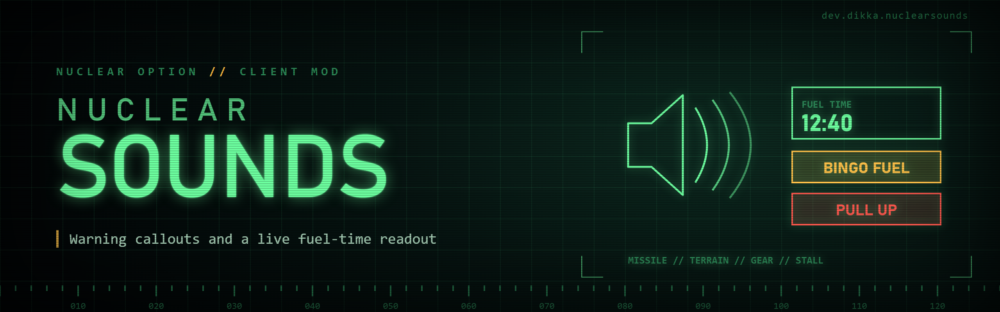

# NuclearSounds

Custom warning audio for Nuclear Option with a local fuel-time readout. Requires BepInEx 5.

Includes incoming-missile seeker callouts, designation gained/lost tones, lower-gear/overspeed/stall voice replacements, fuel-low/bingo warnings, terrain/pull-up warnings, and optional alternate radar-lock/aircraft-loss callouts. Some optional flavor clips contain profanity. Each feature has its existing individual setting.

The fuel-time readout follows the stock fuel gauge's visibility, font and warning color. It estimates endurance from recent fuel consumption, with separate low/bingo thresholds during afterburner-like operation. This is a current-use estimate, not a guaranteed range.

Install the `NuclearSounds` folder containing `NuclearSounds.dll` and the complete `assets/` directory into `BepInEx/plugins/`. Disable the former NuclearTacticalTools plugin before enabling NuclearSounds; they are incompatible because their warning hooks would overlap. NuclearSounds preserves the existing sound settings through the legacy configuration migration helper. Its config file is `BepInEx/config/dev.dikka.nuclearsounds.cfg`.

NuclearTargeting is optional. When installed, its target-selection event supplies the same designation-gained tone trigger as the former combined plugin. Deselection hooks remain available independently. NuclearSounds does not change target selection or add weapon-delivery controls.

Audio clips load asynchronously after warning hooks, generated designation tones and fuel tracking are initialized. Stock built-in warning clips remain available until their replacements are ready, and when replacements are disabled or unavailable. Custom playback uses the game's Interface audio channel and respects its mixer/mute settings.

To check audio, open the configuration menu and tick **NuclearSounds → Audio Test → Play Audio Test**, then close the menu. After two seconds it plays a test tone followed by the lower-gear voice. The action resets automatically and never plays at startup. Relevant playback diagnostics are written to the game log.

Build with the workspace SDK/reference environment using `dotnet build NuclearSounds/NuclearSounds.csproj -c Release`. Building does not install the mod. The optional `scripts/install-mod.sh` copies the built DLL and assets to a configured game installation.
