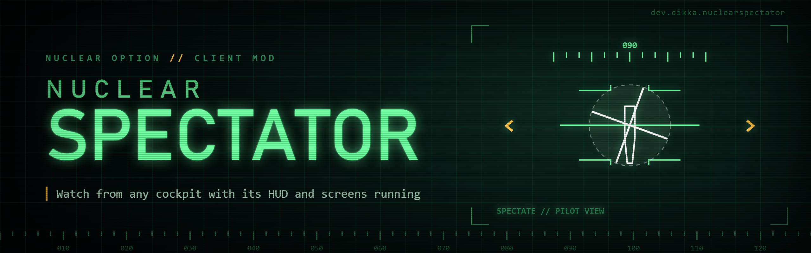

# NuclearSpectator

`NuclearSpectator` is a client-side `Nuclear Option` BepInEx mod that improves spectating other aircraft.

## Features

- **Cockpit view with a working cockpit:** when you have no aircraft of your own and look from another aircraft's cockpit, the mod builds that aircraft's native HUD and cockpit displays, the same ones its pilot sees:
  - HUD: compass, pitch ladder, flight path marker, the helmet speed/altitude/heading readouts, the aircraft's own HUD gauges and its damage display.
  - Cockpit screens: the MFD radar screen, clock and the aircraft's instrument pages.
  - The cockpit stick and throttle move with the pilot's inputs.
  - A target camera on the cockpit screens, aimed at the pilot's first selected target. Other players' aircraft have no native target camera on your client, so the mod builds one from the game's own camera rig. The game's target information overlay is not shown. With NuclearMinimap 0.4.4 or later installed, its cockpit map takes that screen area instead, the whole time you spectate.
  - The weapon and target HUD (target boxes, weapon reticles) stays hidden: it is built around your own target selection.
  - Leaving the cockpit view, switching aircraft or spawning your own aircraft removes all of it again.
- **Move around in the cockpit view:** while you spectate from a cockpit, the free-camera move controls (left stick, or WASD with Left Shift for speed) move your view relative to where you look; on a gamepad the right trigger moves up and the left trigger down. The view stays attached to the aircraft, up to 25 m away, at 7 m/s at full stick. Beyond 1.5 m you see the aircraft's outside and its pilot instead of the cockpit interior. The view reset control (Center) returns to the pilot's eye point. A binding (Lock Horizon, unbound by default; a key, gamepad button or joystick button) switches to a level view: it follows the aircraft's heading but not its pitch or roll, and mouse look and head tracking turn, tilt and roll relative to the horizon.
- **Rotors that spin:** a helicopter (or propeller aircraft) that is already flying when it first appears on your client, for example after you join a server or start spectating, now starts with its rotors at flight speed. Without the mod, the game starts them folded and stopped, and they take about half a minute to spin up while the aircraft flies, which looks broken in every view. This applies to every remote aircraft, also while you fly yourself.
- **No empty HUD:** while you have no aircraft, the game no longer shows its HUD with placeholder text (weapon name, ammo), for example after you close the map in a cockpit view.
- **Hide all UI (F10):** toggles every on-screen interface (HUD, chat, kill feed, map, panels) off for clean video and screenshots. Cockpit screens stay on. It also works while you fly; the pause menu and full map still show.
- **Info panel:** pilot, aircraft type, speed, altitude (sea level and above ground) and heading of the aircraft you follow, at the bottom of the screen. Off in the cockpit view by default, where the HUD shows this.
- **Next/previous aircraft keys:** follow the next or previous aircraft, players sorted by name, optionally AI after them. From the cockpit view you stay in the cockpit view. Players in a team cycle through their own team. They are unbound by default; bind them in Configuration Manager (F1).

Everything uses the game's own prefabs and units. Nothing changes for your own aircraft, and nothing is sent to the server.

## Requirements

- `Nuclear Option`
- `BepInEx 5`

## Installation

1. Install BepInEx for `Nuclear Option`.
2. Build the mod or download a release archive.
3. Extract the `NuclearSpectator` folder into `BepInEx/plugins/`.

```text
BepInEx/
  plugins/
    NuclearSpectator/
      NuclearSpectator.dll
```

## Configuration

Config entries are created automatically after the mod loads.

Main config file:

- `BepInEx/config/dev.dikka.nuclearspectator.cfg`

Bindings (Hide All UI, Lock Horizon, Next Aircraft, Previous Aircraft): in F1, select **Add binding** and press a key (with Ctrl, Shift or Alt for a combination), a mouse button, a gamepad button, trigger or D-pad direction, or a joystick button, hat or axis direction. **Remove** deletes one control. A gamepad binding works on any gamepad; a joystick binding belongs to that device and waits while it is disconnected. Bindings add to the game's own bindings. They do nothing while you type, in the pause menu, with F1 open or without focus; Lock Horizon also waits while the full map is open. The first time a bound control fires, the log records it (`Binding 'Lock Horizon' fired from ...`).

Defaults:

```ini
[General]
Enabled = true
Hide All UI = F10

[Cockpit View]
Show HUD = true
Show Cockpit Screens = true
Animate Stick And Throttle = true
Show Target Camera = true
Hide Empty HUD = true

[Cockpit Movement]
Enabled = true
## Metres per second at full stick
Move Speed = 7
## Metres
Max Distance = 25
Show Exterior Beyond = 1.5
Triggers Move Up And Down = true
Lock Horizon =

[Rotors]
Fix Rotors Of Aircraft Already In Flight = true

[Info Panel]
Show Info Panel = true
Show In Cockpit View = false
Font Size = 22

[Aircraft Cycling]
Next Aircraft =
Previous Aircraft =
Include AI Aircraft = false
Keep Cockpit View = true
```

All values apply live through Configuration Manager. Changing a cockpit setting rebuilds the current cockpit view.

## How it works

The game creates an aircraft's HUD gauges and damage display (`AircraftParameters.StatusDisplay` and `HUDExtras`) only for your own aircraft, and its cockpit creates the MFD screen (`TacScreen`) only for the aircraft on your `CombatHUD`. While you spectate in a cockpit, the mod instantiates the same prefabs for the followed aircraft and enables its `Cockpit` animation.

Several native components look up their aircraft through `CombatHUD.aircraft` or `GameManager.GetLocalAircraft`, which are empty while you spectate. Harmony transpilers rewrite exactly those reads in the HUD and MFD app managers, the artificial horizon, the pylon, engine and radar-warning displays and the helmet display. The rewritten read returns the native value, or the spectated aircraft only while one of the mod's own copies (or the helmet display, during a spectator cockpit view) runs. `CombatHUD.aircraft` itself is never written, so targeting, input and other mods see no change.

Some native components never unsubscribe from aircraft events, because they normally live until the aircraft is disabled. Before the mod removes its copies early, it removes every event handler that points to them, so a later aircraft event cannot fail on a destroyed component.

Remote aircraft choose their rotor and propeller start state in `Unit.onInitialize`, at their spawn point and before the first network position arrives. The first network position calls `Aircraft.SpawnedInPosition`, which measures the real radar altitude and already warm-starts the turbines. The mod repeats the native rotor and propeller start at that moment, with the game's own airborne test.

The game log lists, once per aircraft type, which native components the spectator cockpit created. It also reports any failure once, with its stack, and disables only the affected part.

## Client testing

On 2026-10-29 the user ran 0.1.0 in their client: rotors of helicopters already in flight spun correctly, and the cockpit screens did not work. Cause: other players' aircraft never get a `TargetCam` (it needs network authority), and `TacScreen.Initialize` subscribes to it unconditionally, so it threw and the mod removed the screen. 0.1.1 guards that subscription with a transpiler, and adds cockpit movement. 0.1.2 adds the target camera, trigger up/down movement, empty-HUD hiding and Hide All UI. On 2026-10-30 the user reported that in 0.1.2 nothing worked (F10, cockpit screens, stick animation) and the placeholder HUD still appeared after closing the map; the info panel was also missing, so the runtime was not running. 0.1.3 keeps settings and the runtime independent of the BepInEx plugin component (which BepInEx can destroy early), starts the runtime before patching, shows an in-game "is running" message and logs why a cockpit view gets no spectator cockpit and what the cockpit screen renders into. It also adds Lock Horizon and raises the move speed default to 7 m/s (saved 5 becomes 7). The user's 0.1.3 log (read on their PC) showed the plugin loaded, patches applied and the horizon lock toggling, but no line from the separate DontDestroyOnLoad runner object, so its per-frame work never ran; the info panel was off in their config. 0.1.4 drops that object and ticks the per-frame work from the plugin's LateUpdate and a CameraStateManager.LateUpdate postfix, at most once per frame. On 2026-10-30 the user ran 0.1.4: Hide All UI worked, the cockpit screens showed, and the target camera was a black square; the log showed the cockpit built for three aircraft types and the damage display copy throwing in native engine damage. On 2026-10-30 the user reported that Lock Horizon worked from a key but not from a controller button: it was a BepInEx keyboard shortcut, which reads Unity's legacy input, and the game's controllers only reach mods through Rewired. 0.1.5 moves all four bindings to the shared binding editor (`Shared/NuclearBindings`), which reads controllers through Rewired; saved keys carry over. 0.1.6 swallows the damage display exception for the spectator's copy only, gives the target camera the native exposure, fog handling and nose/tail mounts and logs its camera setup, skips it when NuclearMinimap 0.4.4+ shows its map on that screen, and makes the horizon lock a level frame that mouse look and head tracking turn in. 0.1.6 is not yet run in a client. Offline checks cover the cycling order, the native methods and IL reads the mod depends on, and compiled field types. They do not establish rendering, lifecycle or rotor behavior. See `tests/SMOKE-TESTS.md` for the client checks.

## Local Development Install

For local installs during development:

1. Copy the workspace `.env.example` to `.env`
2. Set `STEAMAPPS_DIR`
3. Run:

```bash
./scripts/install-mod.sh -v
```

## Building

```bash
dotnet build NuclearSpectator.csproj -c Release
```

Build output:

- `bin/Release/NuclearSpectator.dll`
