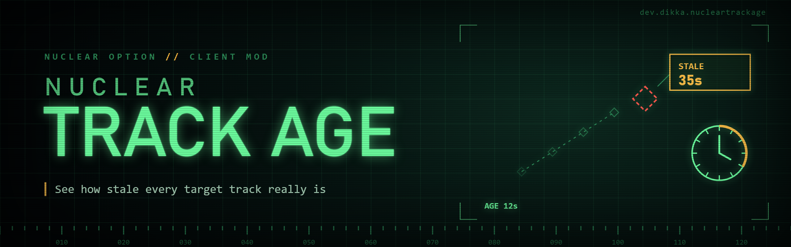

# NuclearTrackAge

NuclearTrackAge is a client-side Nuclear Option BepInEx mod that annotates stale target tracks with how old the last known position is.

Instead of trying to show an absolute timestamp, it displays an age such as `AGE 12s`, `STALE 35s`, or `STALE 3m15s`, which makes it easier to ignore target tracks that have not been spotted recently.

## What it changes

When an enemy target has tracking data, NuclearTrackAge can append the track age to:

- maximized dynamic-map target info labels
- target selector list rows
- target camera grid readout
- small HUD target info for the selected target

By default, labels only appear after the game considers the target position outdated. At 35 seconds, the label switches from `AGE` to `STALE`.

Labels are hidden until the track is at least 4 seconds old by default. Position accuracy uses a 20 m threshold on map, camera, and HUD surfaces, and 100 m in the target list. The `STALE` label is an age threshold, not proof that the target has moved. Disabling a surface removes its age annotation on the next successful readout refresh.

## Configuration

After the game loads the plugin once, BepInEx generates:

```text
BepInEx/config/dev.dikka.nucleartrackage.cfg
```

Useful settings:

- `Show Only Outdated Tracks` — keep the UI quiet until a position is stale.
- `Minimum Age Seconds` — hide labels for very fresh tracks.
- `Stale Threshold Seconds` — configurable in BepInEx/config-manager UIs; default `35` seconds.
- Surface toggles for the dynamic map, target list, target camera, and HUD target info.

## Manual install

Copy `NuclearTrackAge.dll` into:

```text
BepInEx/plugins/NuclearTrackAge/
```

Or use the workspace install script from this mod directory or the repository root:

```bash
bash NuclearTrackAge/scripts/install-mod.sh -v
```
