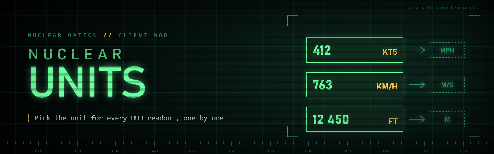

# NuclearUnits

`NuclearUnits` is a client-side `Nuclear Option` mod that lets you choose units per HUD readout instead of relying on the game's single global metric/imperial setting.

The goal is simple: if you want one speed readout in `kts`, another in `mph`, altitude in `ft`, and some other display left on the game's default behavior, you can do that.

## Features

- Per-readout unit overrides for major HUD displays
- HUD-focused implementation rather than a game-wide unit replacement
- Separate unit choices for speed, altitude, climb rate, and range where those readouts exist
- Falls back to the game's default formatting when you choose `GameDefault`
- Optional dual-speed HUD readout with a smaller secondary line on supported flight displays
- Secondary speed defaults to disabled and does not change the stock text layout while unused
- Supports both TextMeshPro flight readouts and legacy landing-screen text

## Current HUD Coverage

The current version supports separate configuration for these readouts:

- `Altitude HUD`
  - radar altitude
  - absolute altitude
- `Speed Gauge`
  - airspeed
- `Basic Flight Instruments`
  - airspeed
  - altitude
  - climb rate
- `Climb Rate HUD`
  - climb rate
- `Virtual MFD`
  - speed
  - altitude
- `Landing Screen`
  - altitude
  - speed
  - vertical speed
  - horizontal speed
- `Target Marker`
  - speed
  - altitude
  - range
- `Target Screen`
  - distance
  - altitude
  - relative altitude
  - speed
  - relative speed

## Supported Unit Choices

- Speed:
  - `GameDefault`
  - `KilometersPerHour`
  - `Knots`
  - `MilesPerHour`
- Secondary speed overlay:
  - `Disabled`
  - `GameDefault`
  - `KilometersPerHour`
  - `Knots`
  - `MilesPerHour`
- Altitude:
  - `GameDefault`
  - `Meters`
  - `Feet`
- Climb rate:
  - `GameDefault`
  - `MetersPerSecond`
  - `FeetPerMinute`
- Distance:
  - `GameDefault`
  - `Metric`
  - `Imperial`

## Requirements

- `Nuclear Option`
- `BepInEx 5`

BepInEx install guide:

- https://docs.bepinex.dev/articles/user_guide/installation/index.html

## Installation

1. Install BepInEx for `Nuclear Option`.
2. Build the mod or download a release archive.
3. Extract the `NuclearUnits` folder into `BepInEx/plugins/`.

The final layout should look like this:

```text
BepInEx/
  plugins/
    NuclearUnits/
      NuclearUnits.dll
```

## Configuration

Config entries are created automatically after the mod loads.

Main config file:

- `BepInEx/config/dev.dikka.nuclearunits.cfg`

You can configure the mod through:

- the config file directly
- BepInEx Configuration Manager, if you use it

Example config values look like this:

```ini
[Dual Speed HUD]
## Optional second speed unit shown on a smaller line below supported HUD speed readouts.
# Setting type: SecondarySpeedUnit
# Default value: Disabled
Secondary Speed Unit = MilesPerHour

[Speed Gauge]
## Unit override for the main speed gauge airspeed readout.
# Setting type: SpeedUnit
# Default value: GameDefault
Airspeed = Knots

[Altitude HUD]
## Unit override for the radar altitude readout.
# Setting type: AltitudeUnit
# Default value: GameDefault
Radar Altitude = Feet
```

## Scope

This mod currently targets HUD and HUD-like readouts only.

It does not currently replace unit formatting everywhere in the game, such as:

- encyclopedia pages
- mission editor screens
- general UI that is outside the patched HUD surfaces

That is intentional. The current implementation is aimed at cockpit and tactical displays where per-readout preferences matter most.

## Limitations

- The stock game still has its built-in global `UnitSystem` setting.
- `GameDefault` means a readout will still follow that stock global behavior.
- The secondary speed line is currently applied to supported flight speed HUD readouts, not every speed label in the game.
- Enemy map-marker speed, altitude, and range remain hidden while the game's tracking position is inaccurate.

## Local Development Install

For local installs during development:

1. Copy `.env.example` to `.env`
2. Set `STEAMAPPS_DIR`
3. Run:

```bash
./scripts/install-mod.sh -v
```

## Building

This project builds against your local `Nuclear Option` and `BepInEx` assemblies.

Standard local build:

```bash
dotnet build NuclearUnits.csproj -c Release
```

Build output:

- `bin/Release/NuclearUnits.dll`

## Roadmap

- expand per-readout coverage further if needed
- expand optional dual-unit displays to more HUD elements if needed
- possibly add a friendlier in-game config UI later
