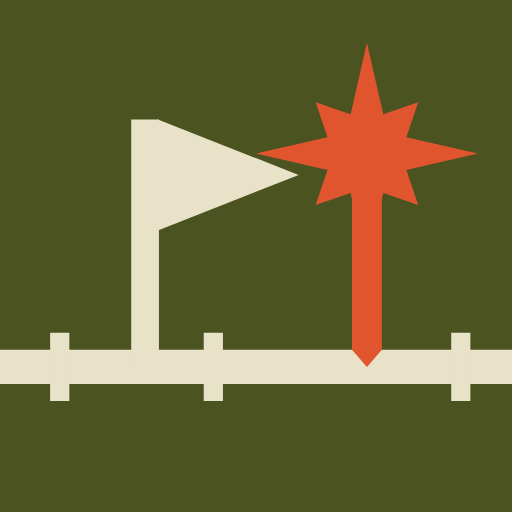
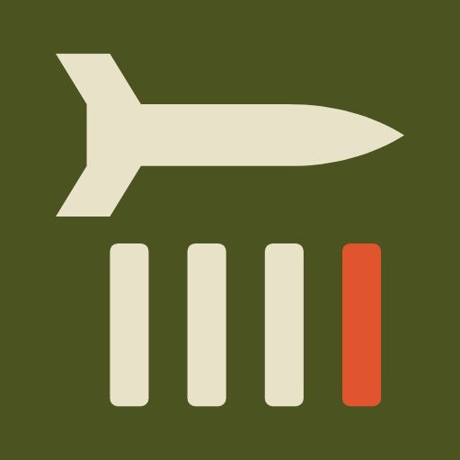
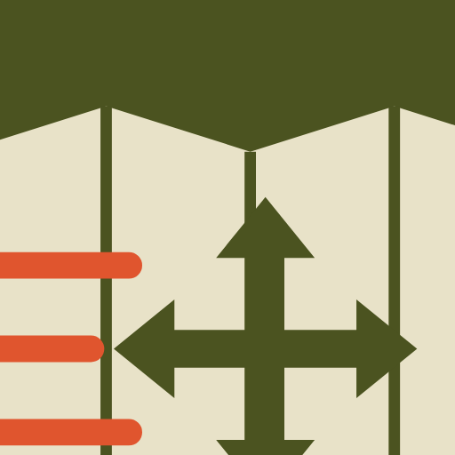
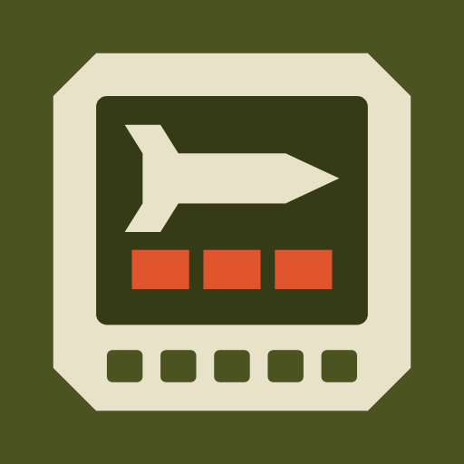
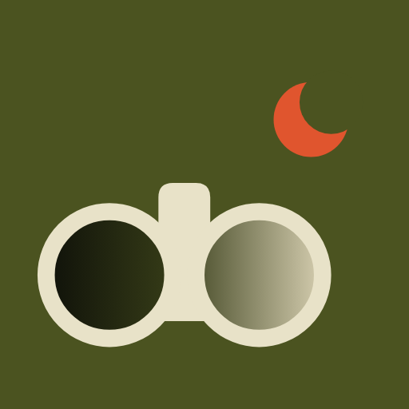
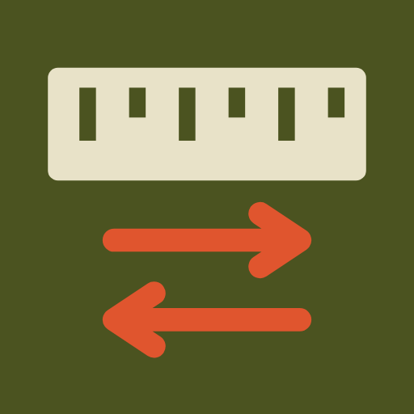

# Nuclear Option client mods

Source for regular (non-VR) BepInEx 5 client mods for Nuclear Option.
This repository holds published source snapshots and releases only, not the
private development history.

## Mods

| Mod | Version | Plugin ID | Description |
| --- | --- | --- | --- |
| [](NuclearConnectivity/) [`NuclearConnectivity`](NuclearConnectivity/) | 0.2.7 | `dev.dikka.nuclearconnectivity` | Client-side Nuclear Option mod for external integrations, currently Steam Timeline combat markers. |
| [](NuclearControllerGestures/) [`NuclearControllerGestures`](NuclearControllerGestures/) | 0.2.2 | `dev.dikka.nuclearcontrollergestures` | Configurable additive controller double-press bindings for native button actions; original controls remain available. |
| [](NuclearDeathBlackout/) [`NuclearDeathBlackout`](NuclearDeathBlackout/) | 0.2.7 | `dev.dikka.nucleardeathblackout` | Client-side Nuclear Option mod that cuts to black and briefly mutes audio when the local main pilot dies. |
| [](NuclearDelivery/) [`NuclearDelivery`](NuclearDelivery/) | 0.1.8 | `dev.dikka.nucleardelivery` | Missile and bomb delivery counters on the target camera and cockpit MFD: flight, reported armor contact and lost deliveries. |
| [](NuclearLiveFeed/) [`NuclearLiveFeed`](NuclearLiveFeed/) | 0.4.0 | `dev.dikka.nuclearlivefeed` | Live tactical map on a second screen: open map.scramd.com in Chrome or Edge while you fly. Shows your side’s known contacts, missile warnings, estimated air-defense areas and runway guidance. Inspect or pin aircraft, pick game targets and copy grid calls for your team. Join a side and take an aircraft for flight readouts and target picking. |
| [](NuclearMapMarkings/) [`NuclearMapMarkings`](NuclearMapMarkings/) | 0.1.7 | `dev.dikka.nuclearmapmarkings` | Client-side Nuclear Option mod that adds pilot markings to the dynamic map and minimap: runways with approach centerlines, range rings and predicted paths, each with its own full-map and minimap switch. |
| [](NuclearMapPan/) [`NuclearMapPan`](NuclearMapPan/) | 0.1.1 | `dev.dikka.nuclearmappan` | Client-side Nuclear Option mod that moves the expanded map faster with a controller stick, with an adjustable stick curve and top speed. |
| [](NuclearMapPlayerNames/) [`NuclearMapPlayerNames`](NuclearMapPlayerNames/) | 0.2.8 | `dev.dikka.nuclearmapplayernames` | Client-side Nuclear Option mod that shows multiplayer usernames next to player-controlled aircraft on the dynamic map. |
| [](NuclearMapTrails/) [`NuclearMapTrails`](NuclearMapTrails/) | 0.1.6 | `dev.dikka.nuclearmaptrails` | Client-side Nuclear Option mod that draws fading, altitude-shaded flight trails behind player aircraft on the dynamic map, own team only by default. |
| [](NuclearMfdWeapons/) [`NuclearMfdWeapons`](NuclearMfdWeapons/) | 0.1.9 | `dev.dikka.nuclearmfdweapons` | Cockpit weapon, ammunition and countermeasure display with a brief loadout preview and optional stock HUD. |
| [](NuclearMinimap/) [`NuclearMinimap`](NuclearMinimap/) | 0.5.3 | `dev.dikka.nuclearminimap` | Native minimap orientation and hold zoom, with an optional cockpit map display and configurable HUD visibility. |
| [](NuclearNightVision/) [`NuclearNightVision`](NuclearNightVision/) | 0.1.1 | `dev.dikka.nuclearnightvision` | Client-side Nuclear Option mod that fades smoothly into and out of night vision instead of switching instantly, with configurable fade times. |
| [](NuclearSatelliteMap/) [`NuclearSatelliteMap`](NuclearSatelliteMap/) | 0.2.3 | `dev.dikka.nuclearsatellitemap` | Satellite imagery with transparent water on the native map, with per-view opacity. Includes the Heartland and Ignus map data. |
| [](NuclearSounds/) [`NuclearSounds`](NuclearSounds/) | 0.1.6 | `dev.dikka.nuclearsounds` | Client-side designation tones, voice callouts, and fuel/terrain warnings with estimated fuel time. |
| [](NuclearSpectator/) [`NuclearSpectator`](NuclearSpectator/) | 0.1.13 | `dev.dikka.nuclearspectator` | Client-side Nuclear Option mod that improves spectating: the HUD, cockpit screens and moving stick in the cockpit view of the aircraft you watch, correctly spinning rotors on helicopters already in flight, an info panel and next/previous aircraft keys. |
| [](NuclearTargeting/) [`NuclearTargeting`](NuclearTargeting/) | 0.2.6 | `dev.dikka.nucleartargeting` | Client-side alternative target selection with optional cycling and tap-selection caps. |
| [](NuclearTrackAge/) [`NuclearTrackAge`](NuclearTrackAge/) | 0.1.7 | `dev.dikka.nucleartrackage` | Client-side Nuclear Option mod that annotates stale enemy target tracks with how old the last known position is. |
| [](NuclearUnits/) [`NuclearUnits`](NuclearUnits/) | 1.2.8 | `dev.dikka.nuclearunits` | Client-side Nuclear Option mod that lets players choose units per HUD readout instead of relying only on the game's global metric/imperial setting. |

Each publication contains all of these mods at the versions shown.

## Requirements

- The .NET 10 SDK.
- A Nuclear Option client with BepInEx 5 installed.
- The game and BepInEx reference assemblies from your own installation. They are
  proprietary, are not part of this repository, and must not be committed or
  redistributed. Point the build at them with the two settings below.

## Build

```bash
git clone https://github.com/dikkadev/nuclear-option-client-mods.git
cd nuclear-option-client-mods
cp .env.example .env   # then edit the paths for this machine
set -a; source .env; set +a
```

Set `NO_MANAGED_DIR` to the game `NuclearOption_Data/Managed` folder and
`NO_BEPINEX_CORE_DIR` to the `BepInEx/core` folder, as environment variables or
as the MSBuild properties `NuclearOptionManagedDir` and `BepInExCoreDir`:

```bash
dotnet build NuclearConnectivity/NuclearConnectivity.csproj -c Release \
  -p:NuclearOptionManagedDir="/path/to/NuclearOption_Data/Managed" \
  -p:BepInExCoreDir="/path/to/BepInEx/core"
```

Build every project listed above the same way. Building does not install
anything: copy a built plugin into `BepInEx/plugins/<ModName>/` yourself.

## Checks

The `tests/` folder holds dependency-free logic checks, a metadata check against
your own client assemblies, and runtime acceptance notes in `tests/SMOKE-TESTS.md`.
Passing offline checks does not prove in-game behavior; see the notes for what
still needs a real client.

## Licensing

This README does not grant a license. Rights in this source are governed by a
`LICENSE` file where one is supplied, and third-party material by the
`THIRD-PARTY-NOTICES.txt` files beside the affected code.
